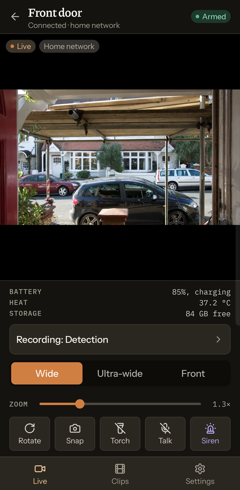
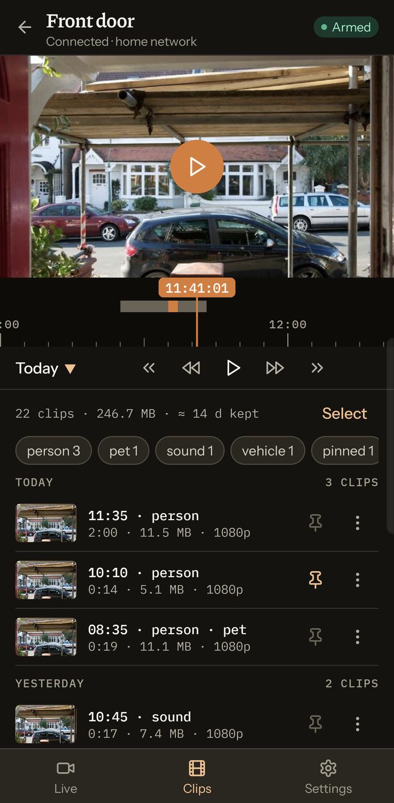
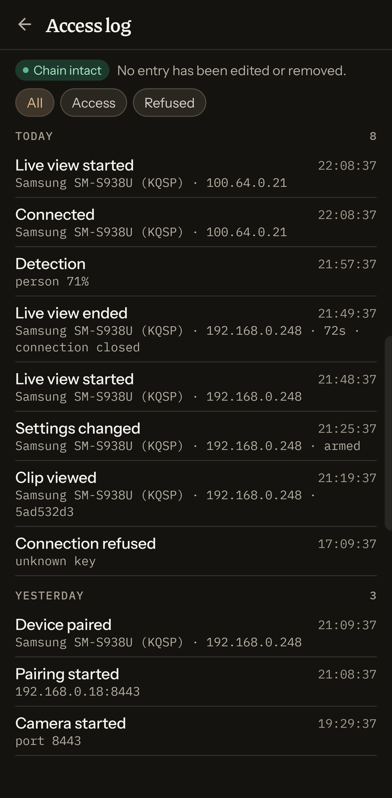
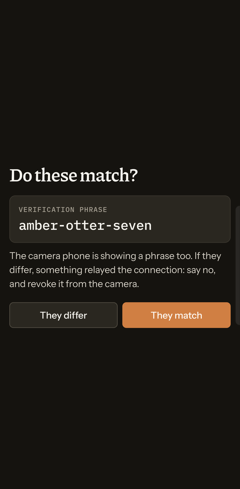
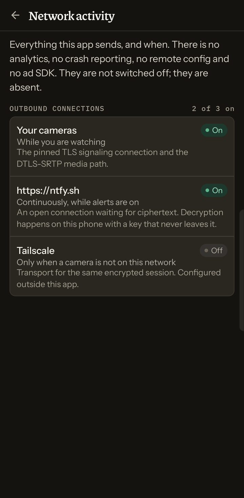
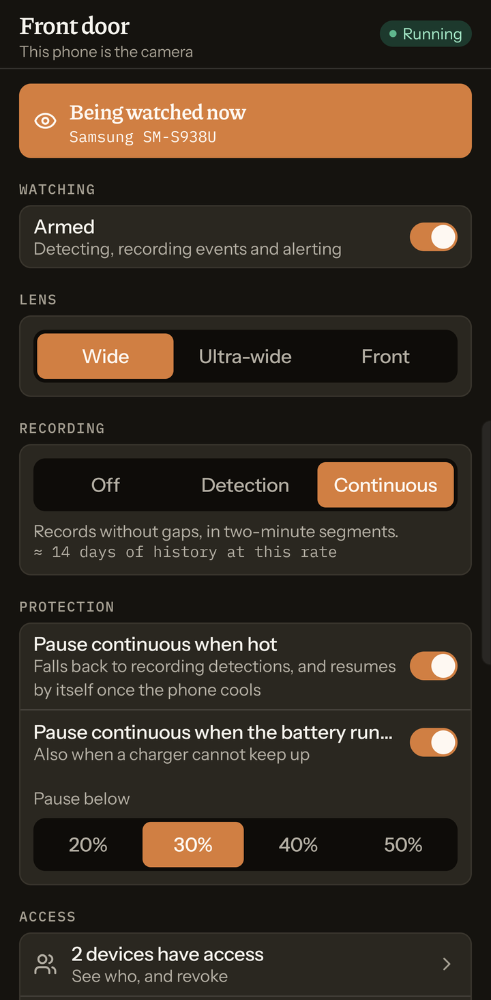
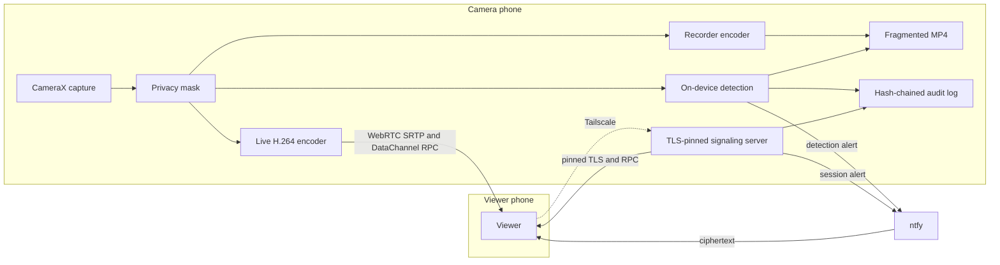

# homecam

An old Android phone is the camera and the signaling server. Your daily phone is the viewer.

Two phones, and no cloud account between them. Pairing pins each viewer's key, the camera shows how many devices have access, and every access is written to a tamper-evident log on the camera.

## Screenshots

Sample data from the debug build's screen gallery (`GalleryActivity`), captured on a phone. The camera feed is a stand-in photo, ["View from front door"](https://www.flickr.com/photos/27532236@N00/6841655600) by humbert15 (CC BY 2.0), shipped only in debug builds.

<table>
  <tr>
    <td width="33%"></td>
    <td width="33%"></td>
    <td width="33%"></td>
  </tr>
  <tr>
    <td valign="top"><b>Live view.</b> WebRTC video from the camera phone, with lens, zoom, torch, talk and siren controls and the camera's battery, heat and storage.</td>
    <td valign="top"><b>Clips.</b> Recordings on a timeline, tagged by on-device detection (person, pet, sound, vehicle) and kept for a fixed number of days.</td>
    <td valign="top"><b>Access log.</b> Every session, settings change and refused connection goes into an append-only hash chain, and the header reports whether the chain verifies.</td>
  </tr>
  <tr>
    <td width="33%"></td>
    <td width="33%"></td>
    <td width="33%"></td>
  </tr>
  <tr>
    <td valign="top"><b>Pairing.</b> Both phones show a verification phrase. If the phrases differ, something is relaying the connection.</td>
    <td valign="top"><b>Network activity.</b> Every outbound connection the app makes and why it exists. There is no analytics, crash reporting or remote config.</td>
    <td valign="top"><b>Camera side.</b> The old phone shows who is watching right now. It pauses continuous recording when it runs hot or the battery runs low.</td>
  </tr>
</table>

## Architecture

CameraX runs for as long as the camera service does. A privacy mask sits on those frames before any consumer, so a masked region is absent from both the live stream and the recording. The masked frames feed the recorder's encoder continuously, and a second encoder for live H.264 only while a viewer is connected. The same frames, after a motion gate, feed on-device object detection. When sound detection is on, the microphone feeds on-device sound classification. The camera also runs a TLS-pinned signaling server that admits only paired keys. RPC prefers the WebRTC DataChannel while a session is up, and uses that signaling socket otherwise. An append-only hash chain records access. Off the LAN, Tailscale is how the viewer reaches the camera. Alerts leave as ciphertext for ntfy.



`:core` is pure JVM — the wire protocol, crypto, handshake, RPC, audit chain, retention, and detection policy — and has no Android imports. `:app` is signaling, WebRTC, capture, detection, recording, and both UIs. One APK carries both roles; the phone's role is chosen at first launch.

## Design

[docs/PLAN.md](docs/PLAN.md) is the design: threat model, wire protocol, storage, and the media pipeline. [docs/DECISIONS.md](docs/DECISIONS.md) records where the build diverged from that plan, and why. The notes below are the load-bearing ones.

### Pairing pins a Keystore P-256 key

PLAN §2.2 wants an identity key generated on the device, hardware-backed where the phone allows it, and never exported. D1 uses secp256r1 with ECDSA-SHA256. Android Keystore's Ed25519 support starts at API 33 and is missing on some of those devices, so on `minSdk` 26 an Ed25519 key would have lived in app storage. P-256 has been Keystore-native since API 23. The camera's self-signed TLS certificate is issued from that same key, which Conscrypt can use. The trade-off is a curve the plan did not name, in exchange for a non-exportable key on every phone the app supports.

D4 then drops the certificate fingerprint from the pairing QR. A second pin of the same key can only disagree with the first. The viewer pins the public key and checks the served certificate against it, which still holds if the camera reissues the certificate. The handshake transcript binds the hash of the certificate on this connection, read after TLS completes, so the signature is about the channel that was actually opened. Dropping the field brings the invite back inside a version-10 QR.

Pairing itself is the only moment trust is created. It has to be started on an unlocked camera, lasts 120 seconds, and works once. Both phones then show a short verification phrase derived from the transcript (D2 renders it as eight characters). The two displays are a side-by-side match, which is what defeats a relay during that window.

### The recorder keeps its own encoder

PLAN §6 shares one H.264 encode between the live session and the file, to keep an old phone cool. D6 keeps a single encoder on the continuous path — the state the camera is in almost all of the time — and starts a second encoder only for the minutes a viewer is connected. Feeding the file from WebRTC's encoder would tie the recording to congestion control, so a busy network would degrade the clip that has to be good later. The recording keeps its own bitrate. The cost is a second encoder during the rare watched state.

D11 lets the recorder pick a hardware HEVC encoder, at 60% of the H.264 bitrate for the same quality, and fall back when the phone has no hardware HEVC encoder. A software encoder would spend more battery than the smaller file saves. The live path stays H.264, because its bitrate is already chosen by congestion control. D10 writes fragmented MP4 with media3, so a power cut loses the open fragment. `MediaMuxer` would have left a file with no index. Both encoders read the same masked frames.

### RPC uses whichever authenticated channel is up

PLAN §4.2 puts every non-media call on the WebRTC DataChannel. D5 sends RPC on the DataChannel when one is open, and on the signaling WebSocket until then. That socket is already a direct, pinned, mutually authenticated connection to the camera, so reading the roster or the battery does not start an encoder. While a session is up, the DataChannel is the path that still works if the WebSocket cannot cross NAT on its own. One `RpcPeer` serves both sockets. The cost is two transports for one protocol.

### The access log has a tail marker outside the database

PLAN §2.7 is a hash chain: each entry covers the previous hash, so an edited row or a gap in the middle fails verification. Deleting the last row leaves a chain that still verifies, and the last row is the natural one to remove — a refused connection, or a session someone wants forgotten. D7 also writes the sequence number and chain hash to a file beside the database after every append, and verification treats a log shorter than that marker as tampering. Someone who can rewrite the database can rewrite the file too. The marker turns a one-statement truncation into a second artifact that has to match. The camera shows the chain on its access-log screen. A session start notifies the other paired viewers; D14 skips the viewer that opened the session, so the alert that matters is the one the owner did not start.

### Alerts are ciphertext, and Tailscale is only a path

Detection runs on the camera. EfficientDet-Lite0 runs on frames that pass a motion gate; YAMNet classifies audio. What those class lists can and cannot say is in [models/README.md](models/README.md). Clips stay in app-private storage (PLAN §2.8).

An alert is encrypted to the viewer's key. The default push endpoint is [ntfy](https://ntfy.sh), which sees a topic and ciphertext. D19 is the constraint on that default: anonymous ntfy.sh allows 250 messages a day per public IP, shared by every device behind the home address, and a self-hosted https server is the escape hatch. D20 holds an ordinary detection alert that would spend the reserve at the end of that budget, and leaves the reserve for urgent, session, and health alerts.

Tailscale is how the viewer reaches the camera from outside the house. It is a network path, and the app does not link against it. The pinned certificate, the handshake, and the allowlist are the same on the tailnet as on the LAN. Setup is in [docs/REMOTE_ACCESS.md](docs/REMOTE_ACCESS.md). PLAN §2.9 is the egress list: the paired peer, the optional push endpoint, and optional Tailscale.

## Build

JDK 17, and an Android SDK with the platform this project compiles against (`compileSdk` 37). On the maintainer's machine, `source ~/android-tooling/env.sh` exports that JDK and SDK. The script is one setup, and any JDK 17 and SDK layout works.

```sh
./gradlew assembleDebug
./gradlew assembleRelease
```

The debug APK is under `app/build/outputs/apk/debug/`. Install the same APK on both phones.

`assembleDebug` and `assembleRelease` are followed by a native-alignment check that fails the build if any packaged `.so` cannot be mapped on a 16 KB page device. Every native library comes from a prebuilt dependency, so the property is decided by the pinned versions (D8).

The default ABI filter is `arm64-v8a`. libwebrtc and LiteRT each ship a native library per ABI. Pass `-Phomecam.abis=arm64-v8a,x86_64` to add the emulator ABI, or list the full set for a build meant to run on other architectures.

Resolved artifacts are checked against [`gradle/verification-metadata.xml`](gradle/verification-metadata.xml).

## Tests

```sh
./gradlew :core:test
```

`:core:test` is pure JVM. It covers the protocol, crypto, handshake, RPC, audit chain, retention, and detection policy, and it needs no device.

Instrumented tests need a device:

```sh
./gradlew :app:connectedDebugAndroidTest
```

Do not run that against a phone that is already paired. Gradle uninstalls the app when the instrumentation finishes, and the identity and the pairings are deleted with it. On a phone in use, install with `adb install -r` and run a single class with `am instrument`.

`tools/test_observe.py` checks the log reviewer with the stdlib `unittest` runner:

```sh
python tools/test_observe.py
```

## Using it

1. Install on both phones. On the old one pick **The camera**. On the daily phone pick **The viewer**.
2. Camera, **Pair a device**. The code lasts 120 seconds and works once.
3. Viewer, **Add a camera**, and scan it.
4. Both phones show a short verification phrase. The two have to match. A mismatch means something relayed the connection: revoke that device and pair again.

The camera's home screen shows how many devices have access. Revoking one drops its key and tears down a live session from it.

## License

[MIT](LICENSE). Copyright (c) 2026 Ethan Zhou.

Fonts, Lucide icons, and the bundled detection models are under their own licenses. See [THIRD_PARTY.md](THIRD_PARTY.md).
